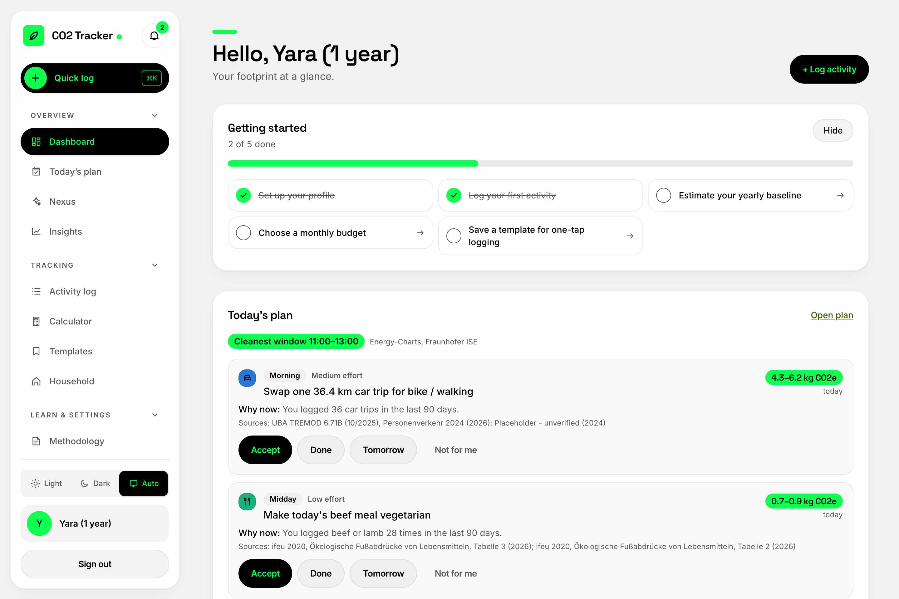
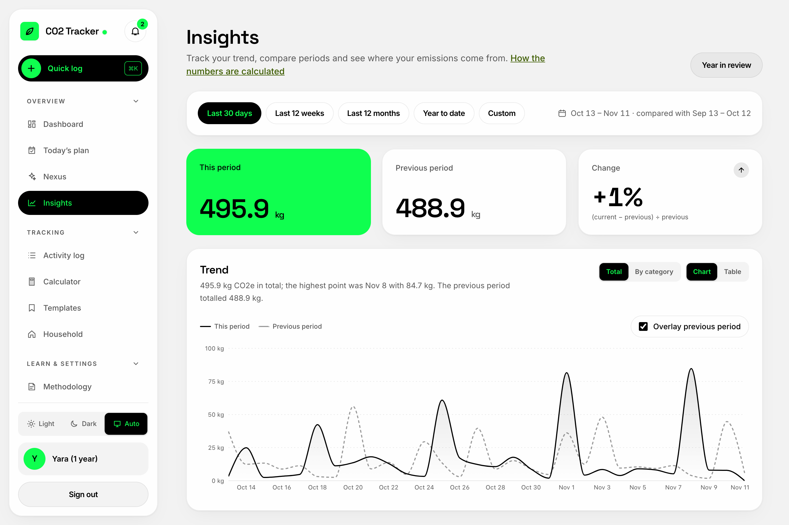
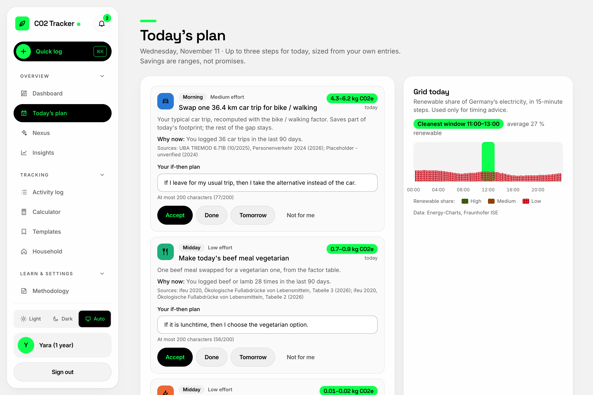
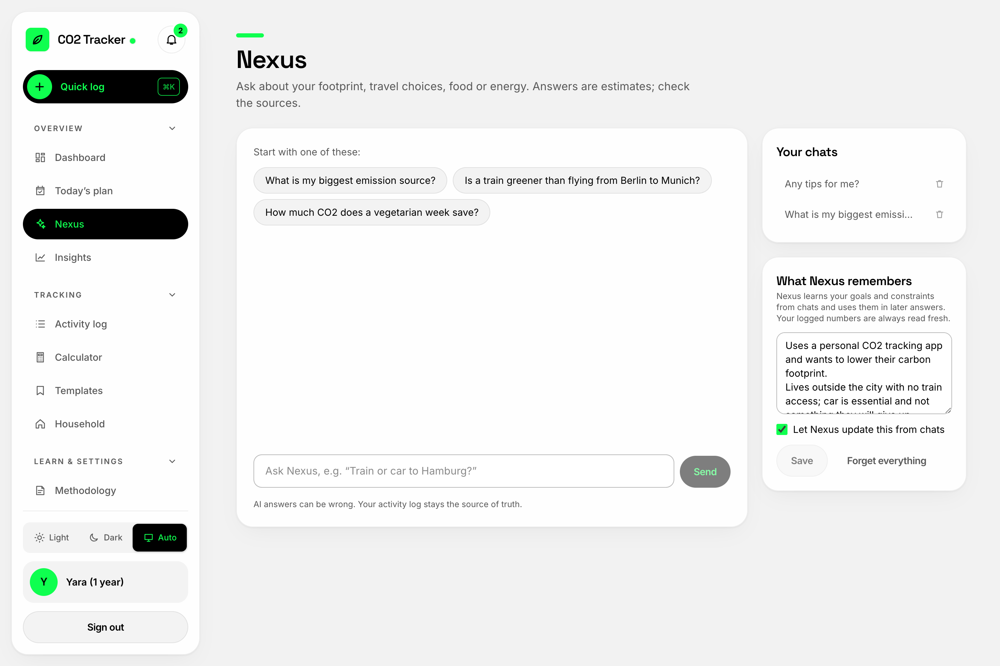
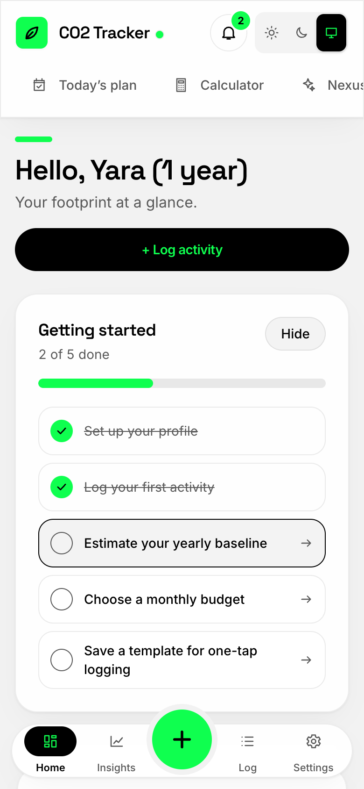

# CO2 Footprint Tracker

An intelligent, full-stack personal carbon footprint tracking and reduction platform built with **Spring Boot 3 (Java 21)**, **React 18 (TypeScript & Tailwind CSS)**, **PostgreSQL 16**, and an embedded AI assistant powered by **Nous Research Hermes Agent** & **Inception Labs Mercury**.

---

## Visual Tour

### Dashboard & Analytics
High-resolution interactive dashboard tracking annual emissions across Transport, Home Energy, Food, Shopping, and Waste against national and global benchmarks.



---

### Insights & Category Breakdown
Comprehensive monthly trends, granularity breakdowns, and comparative emission analyses powered by verified scientific factor models.



---

### Today's Climate Action Plan
Personalized, high-impact emission reduction suggestions ranked dynamically by effort, carbon saving, user habit history, and live clean-grid timing signals.



---

### Nexus AI Assistant
In-app conversational assistant helping users analyze their footprint and explore reduction strategies. Securely proxies requests to Hermes Agent with zero personally identifiable information (PII) passed to the model.



---

### Mobile Responsive PWA
Optimized for mobile and tablet with responsive navigation, quick-logging, and touch gestures.

<p align="center">
  
</p>

---

## Key Features

- **Multi-Category Footprint Tracking**: Log emissions across Transport (cars, public transit, flights, bikes), Home Energy (heating, electricity), Food/Diet, Shopping, and Waste.
- **Scientifically Grounded Engine**: Derived and cited emission factors based on official publications from the German Environment Agency (**UBA** TREMOD 2024 / Strommix 2025), UK **DESNZ 2025**, **ifeu**, and corporate environmental disclosures (**Apple PER**).
- **Clean Grid Awareness**: Real-time electricity carbon intensity signals (Energy-Charts) suggest optimal timing for energy-heavy tasks.
- **Smart Habits & Recurring Activities**: Quick-add templates, "log again" one-tap shortcuts, recurring scheduled entries, and monthly CO2 budget rings.
- **Nexus Assistant with Transparent Memory**: Conversational AI assistant with full user auditability—users can view, modify, or erase what Nexus remembers at any time.
- **Privacy & Security**: Secure JWT with refresh token rotation, per-account lockout defense, CSP headers, strict input validation, and full data export/deletion.

---

## System Architecture

```
Internet ──▶ Caddy / Nginx Reverse Proxy (:8081)
                   │
                   ├──▶ Frontend SPA (React 18, Vite, Tailwind CSS)
                   │
                   └── /api ──▶ Backend API (Spring Boot 3, Java 21)
                                      │
                                      ├──▶ PostgreSQL 16 (Flyway Migrations V1-V11)
                                      │
                                      ├──▶ MailHog / SMTP (:1025) (Email Verification & Digests)
                                      │
                                      └──▶ Hermes Agent Gateway (:8642)
                                                └──▶ Mercury Diffusion LLM (Inception Labs)
```

---

## Setup Instructions

### Prerequisites

- [Docker](https://docs.docker.com/get-docker/) & [Docker Compose](https://docs.docker.com/compose/) (Recommended for fastest setup)
- *Optional for manual local dev*: JDK 21+, Node.js 20+, PostgreSQL 16

---

### Method 1: Full-Stack with Docker Compose (Recommended)

1. **Clone the repository**:
   ```bash
   git clone <repo-url> co2tracker
   cd co2tracker/source_code
   ```

2. **Configure environment variables**:
   ```bash
   cp .env.example .env
   ```
   Generate strong random secrets for `DB_PASSWORD`, `JWT_SECRET`, and `HERMES_API_KEY`:
   ```bash
   # On macOS / Linux
   sed -i '' "s/DB_PASSWORD=.*/DB_PASSWORD=$(openssl rand -hex 16)/" .env
   sed -i '' "s/JWT_SECRET=.*/JWT_SECRET=$(openssl rand -base64 48)/" .env
   sed -i '' "s/HERMES_API_KEY=.*/HERMES_API_KEY=$(openssl rand -hex 32)/" .env
   ```
   *(Optional)* If you have an Inception Labs Mercury API key, provide it under `MERCURY_API_KEY` in `.env`. If left empty or as default, the system automatically uses the bundled local `mock-mercury` service.

3. **Start the application**:
   ```bash
   docker compose up -d --build
   ```

4. **Access the application**:
   - **Web Application**: [http://localhost:8081](http://localhost:8081)
   - **MailHog Inbox** (view email verification links & password resets): [http://localhost:8025](http://localhost:8025)
   - **Backend API**: [http://localhost:8081/api/v1](http://localhost:8081/api/v1)

---

### Method 2: Seed Sample Data (Optional)

To test the application with realistic, year-long carbon footprint history, run the synthetic user seed script:

```bash
cd source_code
python3 scripts/seed_sample_users.py --base http://localhost:8081 --mailhog http://localhost:8025
```

This creates pre-configured demo accounts (passwords saved to `.sample-accounts.txt`):
- `sample.year@co2tracker.test` — 365 days of realistic seasonal activities, diet, flights, and commute data.
- `sample.twomonths@co2tracker.test` — 60 days of activity.
- `sample.tester1@co2tracker.test` — Clean account for manual entries.

---

### Method 3: Local Development (Without Docker)

#### 1. Database & MailHog
Start only the backing services:
```bash
cd source_code
docker compose up -d postgres mailhog
```

#### 2. Backend (Spring Boot 3)
```bash
cd source_code/backend
export DB_PASSWORD=your_postgres_password
export JWT_SECRET=your_base64_jwt_secret_min_32_chars
export COOKIE_SECURE=false
mvn spring-boot:run
```
The API starts on port `8080`.

#### 3. Frontend (React + Vite)
```bash
cd source_code/frontend
npm install
npm run dev
```
Open [http://localhost:5173](http://localhost:5173). The Vite development server automatically proxies `/api` requests to `http://localhost:8080`.

---

## Directory Structure

```
.
├── README.md                  # Project overview & documentation
├── screenshots/               # High-resolution application screenshots
└── source_code/
    ├── backend/               # Spring Boot 3 Java 21 REST API
    │   ├── src/main/java/     # Application source code (Domain modules)
    │   └── src/main/resources/# Application configs & Flyway migrations (V1-V11)
    ├── frontend/              # React 18 / TypeScript SPA
    │   ├── src/features/      # Domain UI components (Analytics, Plan, Nexus)
    │   └── e2e/               # Playwright end-to-end and accessibility tests
    ├── hermes-agent/          # Nous Research Hermes Agent & Mercury LLM integration
    │   ├── config/            # Hardened agent configurations
    │   └── deploy/            # GCP Cloud Run deployment files
    ├── deploy/
    │   └── oracle/            # Production deployment kit for Oracle Cloud Always Free
    ├── scripts/               # Seeding and analytics reporting scripts
    ├── docs/                  # In-depth architectural & methodology specifications
    └── docker-compose.yml     # Multi-container orchestration
```

---

## Testing & Verification

- **Backend Tests**:
  ```bash
  cd source_code/backend && mvn test
  ```
  Runs full API slice tests, entity security checks, and calculation engine assertions using in-memory H2.

- **Frontend Tests**:
  ```bash
  cd source_code/frontend && npm test
  ```
  Runs Vitest component and unit test suites.

- **Typecheck & Production Build**:
  ```bash
  cd source_code/frontend && npm run typecheck && npm run build
  ```

- **End-to-End & Accessibility (a11y)**:
  ```bash
  cd source_code/frontend && npm run e2e
  ```
  Executes Playwright user journeys and automated axe-core WCAG 2.1 AA audits.

---

## License

This project is licensed under the MIT License.
