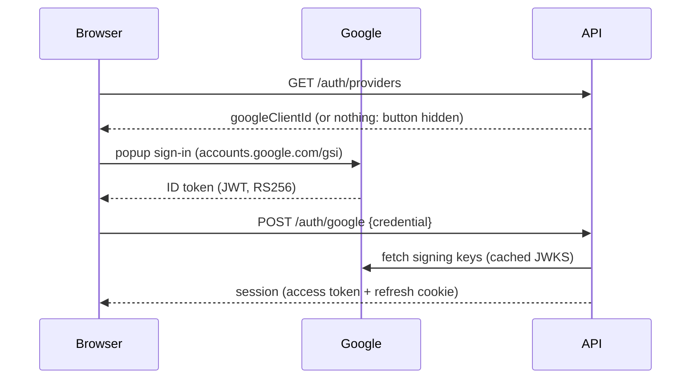

# 06 — Integrations: email delivery and single sign-on

Status: **email works locally against Mailhog; Sign in with Google is built (switched on by `GOOGLE_CLIENT_ID`); other SSO providers are not.**
This document lists what the project owner has to supply to turn each one on, and how the code is wired to receive it.

---

## 1. Email (verification, password reset, notifications)

### 1.1 What exists today
- `auth/MailService` sends verification and password-reset mail through Spring's `JavaMailSender` (plain SMTP).
- Configuration (`application.yml`):

  | Env var | Purpose | Local default |
  |---|---|---|
  | `MAIL_HOST` / `MAIL_PORT` | SMTP server | `mailhog` / `1025` |
  | `MAIL_USER` / `MAIL_PASSWORD` | SMTP credentials | empty |
  | `APP_MAIL_FROM` | From address | `no-reply@co2tracker.local` |
  | `APP_FRONTEND_URL` | Base for links in mails (`/verify-email?token=…`, `/reset-password?token=…`) | `http://localhost:8081` |

- Tokens are random, stored only as SHA-256 hashes, single-use, and expire (verification 24 h, reset 30 min).

### 1.2 What you need to provide
| # | Item | Notes |
|---|---|---|
| 1 | **Provider choice** | Planned: **OCI Email Delivery** (see [07-deploy-oracle-cloud.md](07-deploy-oracle-cloud.md) §3.5). Any SMTP relay works with no code change: Amazon SES, SendGrid, Mailgun, Postmark, Brevo, or a company relay (Microsoft 365 / Google Workspace). |
| 2 | **SMTP host, port, username, password (or API key used as password)** | Port 587 + STARTTLS is the norm. Supply them as secrets, never in git. |
| 3 | **A sending domain you control** (e.g. `mail.example.com`) | Needed for DNS records below. |
| 4 | **DNS records**: SPF, DKIM (provider-generated CNAME/TXT), DMARC (`v=DMARC1; p=quarantine; rua=…`) | Without these, Gmail/Outlook will spam-folder or reject the mail. |
| 5 | **From name and address**, plus a monitored **reply-to / support address** | e.g. `CO2 Tracker <no-reply@mail.example.com>`. |
| 6 | **Public frontend URL** per environment (`APP_FRONTEND_URL`) | Must be HTTPS in production; links in mails point here. |
| 7 | **Leaving provider sandbox** | SES and some others start in sandbox mode (only verified recipients); request production access. |
| 8 | **Notification list and cadence** (if you want more than verification/reset) | e.g. weekly summary, monthly report, "you logged nothing for 7 days" nudge, goal reached. |
| 9 | **Legal footer**: postal address / imprint and unsubscribe policy | Required for non-transactional mail (GDPR/ePrivacy in the EU, CAN-SPAM in the US). Transactional mail (verify/reset) does not need unsubscribe. |
| 10 | **Bounce / complaint webhook endpoint** (optional, recommended) | Lets us stop mailing bad addresses; provider-specific. |

### 1.3 Code changes once details are supplied
- Done: `MAIL_SMTP_AUTH` / `MAIL_SMTP_STARTTLS` env switches (default off for Mailhog; on in `deploy/oracle`).
- **Notifications** (not built yet): a `notification` package with
  - `NotificationPreference` table (per user, per type, opt-in, with an unsubscribe token),
  - a `@Scheduled` job for weekly/monthly digests that reads the `daily_emission` read model,
  - HTML + plain-text templates, and an `List-Unsubscribe` header on non-transactional mail,
  - an outbox table so mails are sent after the transaction commits and retried on failure.

---

## 2. Single sign-on (OpenID Connect)

> **Google is built** (2026-11-09). Other providers still follow the plan below.

### 2.0 Sign in with Google (built)

Free, no Firebase and no client secret: Google's own script draws the button, hands the page a signed
**ID token**, and the API verifies it before opening a normal session (same refresh cookie and access token
as a password sign-in).



**What the API checks** (`GoogleTokenVerifier`): RS256 signature against Google's published keys, `iss` is
Google, `aud` equals our client id, not expired, and `email_verified = true`. Anything else is a 401.

**Accounts** (`AuthService.loginWithGoogle`):

| Situation | Result |
|---|---|
| Google `sub` already linked | Signs into that account |
| No account for the email | New active account, no password, name from Google |
| Confirmed password account with that email | Linked; the password keeps working |
| **Unconfirmed** password account with that email | Linked, and its password and sessions are **removed**: whoever registered it never proved they own the address (account pre-hijacking) |
| Email already linked to a *different* Google account | 403 |
| Disabled account | 403 |

Google-only accounts have no password: password sign-in fails for them, and changing the password or
deleting the account asks them to set one first through "Forgot password".

This links a confirmed account without asking for its password (the plan below suggested asking). Google
proves control of the same mailbox our verification mail does, so the extra step adds friction without
adding proof; revisit if non-Google providers are added.

**To switch it on**

1. In [Google Cloud Console](https://console.cloud.google.com/apis/credentials) create an *OAuth client ID*
   of type **Web application**. Configure the consent screen (app name, support email; scopes `openid`,
   `email`, `profile` only).
2. Under **Authorized JavaScript origins** add every origin the site is served from, e.g.
   `http://localhost:8081` locally and `https://<your-domain>` in production. No redirect URIs are needed.
3. Put the client id in `.env` as `GOOGLE_CLIENT_ID=…apps.googleusercontent.com` and restart the API. The
   client id is public by design; there is no secret to store.

The page's Content-Security-Policy already allows Google's script, button frame and styles
(`frontend/security-headers.conf`).

### 2.1 Recommended design
- Use **OpenID Connect authorization-code flow with PKCE**, handled **by the backend** (`spring-boot-starter-oauth2-client`).
  The browser never sees the provider's tokens; after the callback the backend issues *our* existing access + refresh tokens,
  so the rest of the API and frontend stay unchanged.
- New table `user_identity(provider, subject, user_id, email_at_link, linked_at)` — one user can have password login and
  several SSO identities. The provider's `sub` claim is the key, never the email.
- Frontend: "Continue with Google / Microsoft" buttons on Login and Register that navigate to
  `/api/v1/auth/oauth2/authorize/{provider}`.

### 2.2 What you need to provide (per provider)
| # | Item | Notes |
|---|---|---|
| 1 | **Which providers** | Google, Microsoft Entra ID (personal and/or work accounts), Apple, GitHub, or a company IdP (Okta, Auth0, Keycloak). |
| 2 | **Client ID** and **client secret** | From the provider's developer console; secret delivered as an env secret. Apple uses a signed JWT from a key file instead of a static secret. |
| 3 | **Redirect URIs per environment** | e.g. `http://localhost:8081/api/v1/auth/oauth2/callback/google`, `https://staging.example.com/…`, `https://app.example.com/…` — registered exactly in the console. |
| 4 | **Tenant / audience** (Microsoft) | `common`, `organizations`, `consumers`, or a specific tenant ID. |
| 5 | **Allowed domains** (optional) | e.g. only `@company.com` accounts may sign in. |
| 6 | **Account-linking policy** | Recommended: link an SSO login to an existing password account only when the provider says `email_verified=true`, *and* ask the user to confirm with their password the first time. |
| 7 | **Scopes** | `openid email profile` is enough; nothing else is needed. |
| 8 | **Consent screen details** | App name, logo, support email, **privacy policy URL**, **terms of service URL**, authorised domains. Google requires verification of the consent screen before public launch. |
| 9 | **Sign-out behaviour** | Local sign-out only (default), or also RP-initiated logout at the IdP. |

### 2.3 Environment variables the backend will read
```
OAUTH_GOOGLE_CLIENT_ID=
OAUTH_GOOGLE_CLIENT_SECRET=
OAUTH_MICROSOFT_CLIENT_ID=
OAUTH_MICROSOFT_CLIENT_SECRET=
OAUTH_MICROSOFT_TENANT=common
OAUTH_ALLOWED_EMAIL_DOMAINS=          # optional, comma separated
APP_FRONTEND_URL=https://app.example.com
```
A provider with no client ID configured is simply not offered, so SSO can be enabled one provider at a time.

### 2.4 Security checklist for the implementation
- `state` and PKCE `code_verifier` stored server-side and checked on callback; `nonce` checked in the ID token.
- ID token signature, issuer, audience and expiry validated by Spring Security (JWKS from the provider's discovery document).
- SSO users created as `email_verified=true` only when the provider asserts it; otherwise the normal verification mail is sent.
- Rate limiting and audit log entries on the callback, the same as password login.
